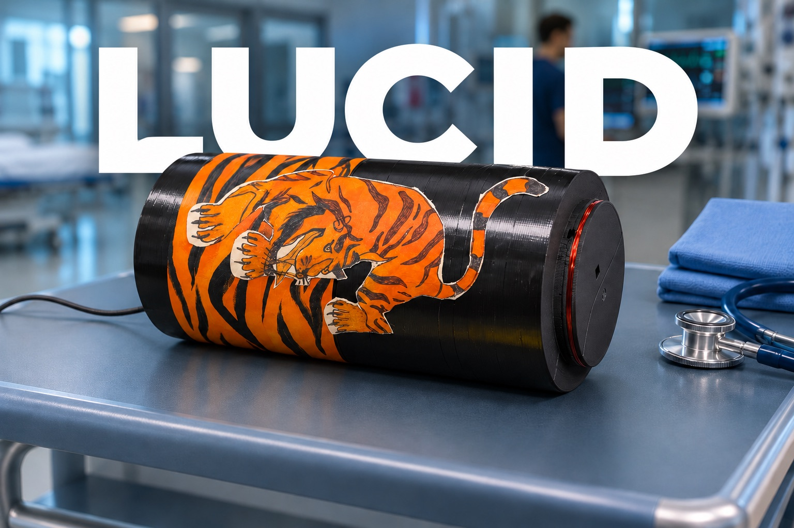
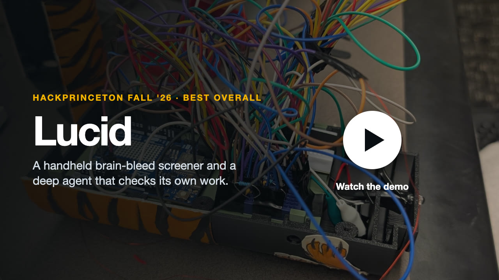
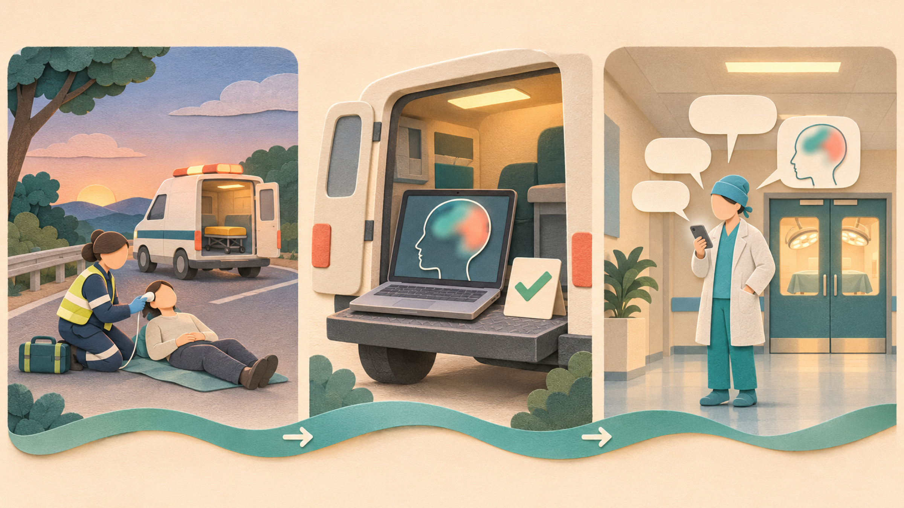
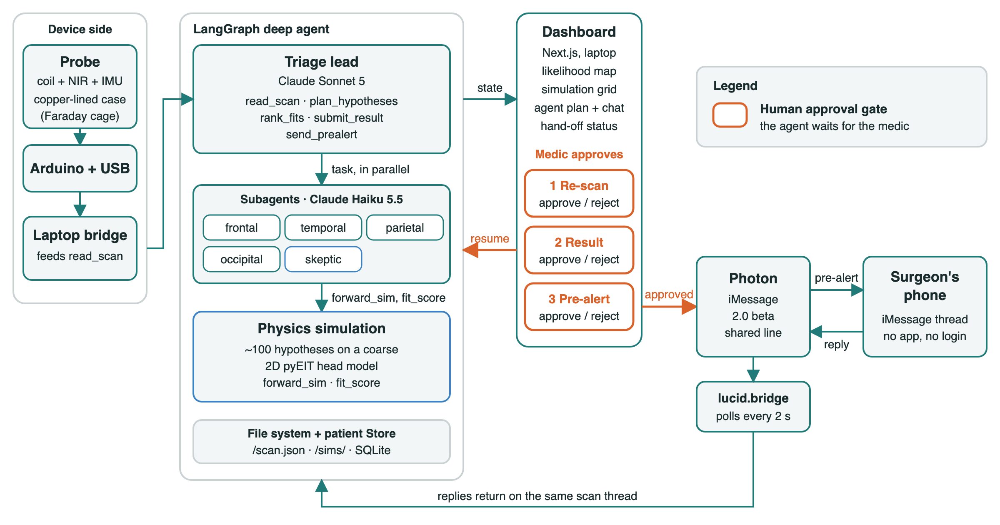
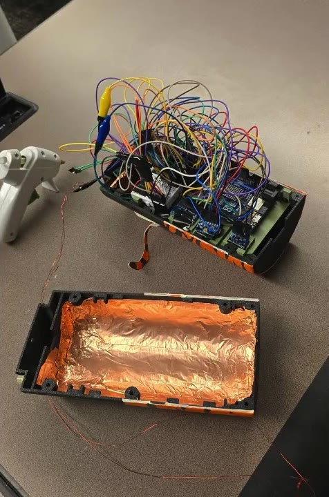
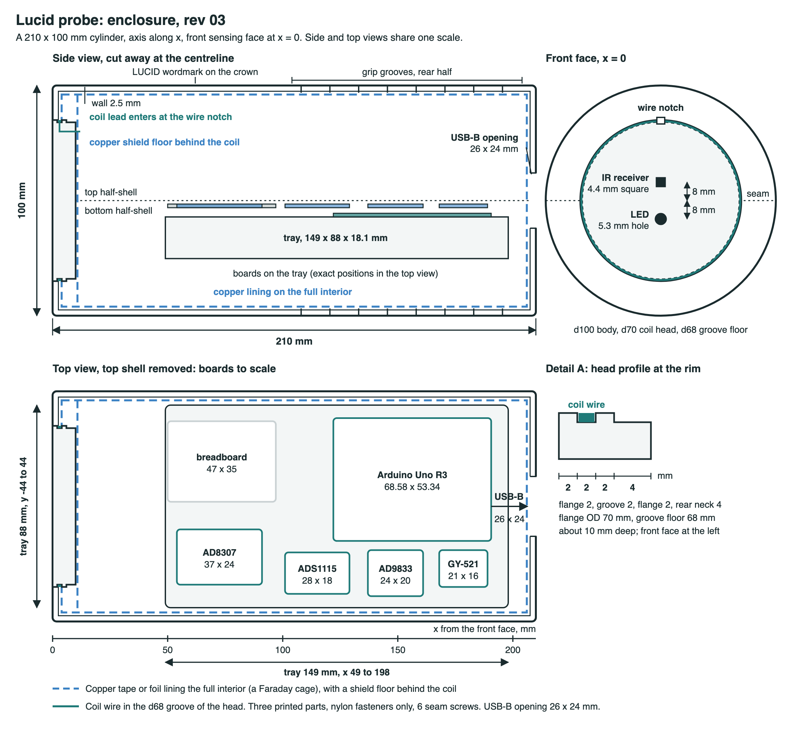
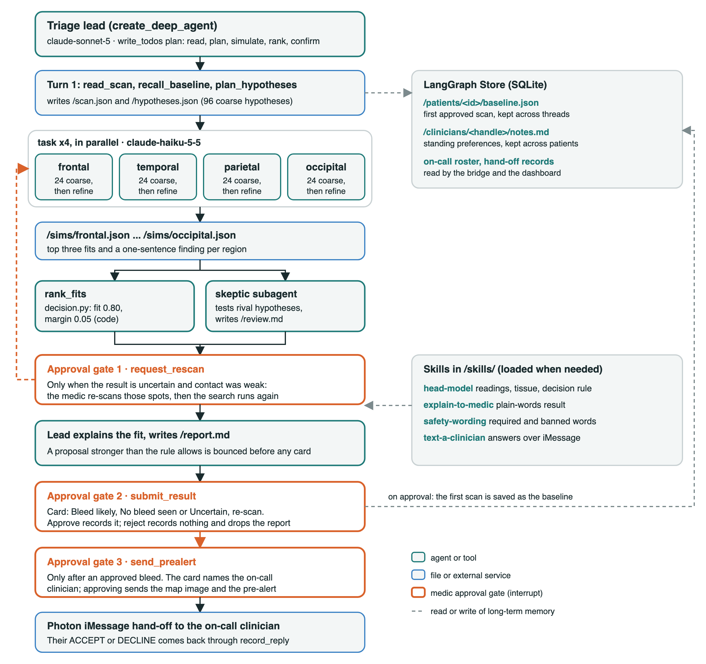
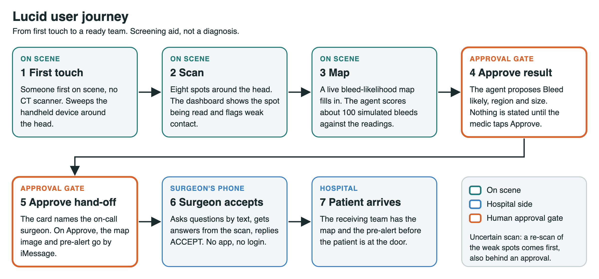
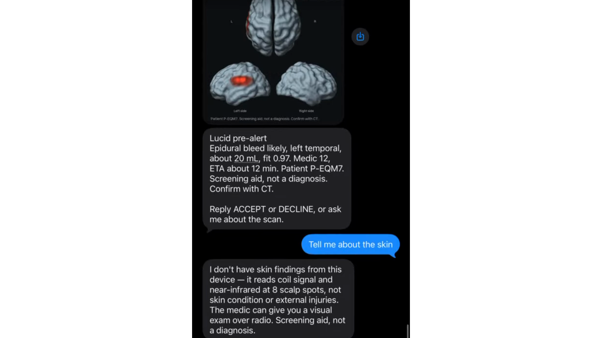
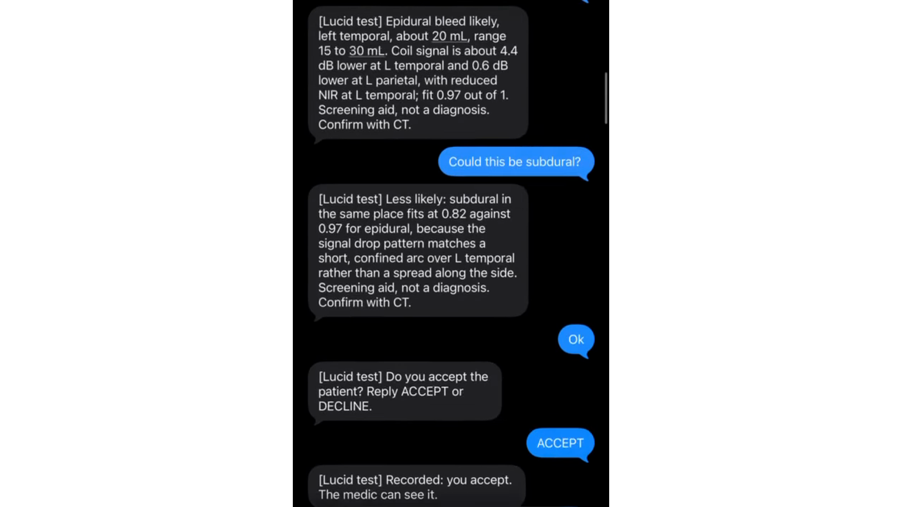

<p align="center">
  <a href="https://youtu.be/IY0Rr7l58Eg"></a>
</p>

<p align="center">
  <b>Brain-bleed screening that happens where the patient is, not at the CT scanner.</b><br>
  A handheld probe, a LangChain deep agent that runs ~100 physics simulations and then tries to disprove its own answer,<br>
  and a pre-alert that reaches the on-call neurosurgeon by iMessage, so they need no app and no login.
</p>

<p align="center">
  <a href="https://devpost.com/software/lucid-k078qt"></a>
  <a href="https://devpost.com/software/lucid-k078qt"></a>
  <br>
  <a href="https://devpost.com/software/lucid-k078qt"></a>
  <a href="https://devpost.com/software/lucid-k078qt"></a>
</p>

<p align="center">
  <a href="https://youtu.be/IY0Rr7l58Eg"><b>Demo video</b></a> ·
  <a href="https://devpost.com/software/lucid-k078qt"><b>Devpost</b></a> ·
  <a href="agent/README.md"><b>Agent design</b></a> ·
  <a href="hardware/README.md"><b>Hardware</b></a> ·
  <a href="#quick-start"><b>Quick start</b></a>
</p>

<p align="center">
  
  
  
  
  
  
  
  
</p>

> [!IMPORTANT]
> Lucid is a hackathon research prototype and a **screening aid, not a diagnosis**. It has not been clinically validated. Every result it shows ends with "Confirm with CT."

---

## 🏆 Awards

Built in one weekend at **HackPrinceton Fall 2026** (Princeton University, November 2026).

| | Prize | Track sponsor |
|:-:|---|---|
| 🏆 | **Best Overall Hack** | HackPrinceton |
| 🤖 | **Best Physical AI Hack** | Justin Bojarski |
| 🦜 | **Best Use of deepagents** | LangChain |
| 🥈 | **Best Practical AI Innovation, 2nd place** | Amazon |

📣 The story of the weekend: [LinkedIn post](https://www.linkedin.com/posts/alan-tai-nu_we-just-won-hackprinceton-fall-2026-share-7527930599345467392-Tl6F/) · [X thread](https://x.com/alan_tai1/status/2122521193227882717) · [Devpost write-up](https://devpost.com/software/lucid-k078qt)

## 🎬 Demo

<p align="center">
  <a href="https://youtu.be/IY0Rr7l58Eg"></a><br>
  <sub>▶ <a href="https://youtu.be/IY0Rr7l58Eg">Watch the demo on YouTube</a></sub>
</p>

## 💡 Why we built it

One of our teammates' grandfathers had a brain hematoma that nearly killed him. Bleeds like his are usually found only once the patient reaches a CT scanner, and by then the hours that matter may already be gone. A hospitalist we spoke with during the event described the same gap: the early signs of brain injury are the hardest part of triage.

Lucid moves the first check to the patient. A first responder sweeps the probe around the head, an agent works out whether a bleed is likely, where it is and how large, and once the medic approves, the receiving neurosurgeon has the map before the ambulance arrives.

<p align="center">
  
</p>

## ⚙️ How it works

| | Step | What happens |
|:-:|---|---|
| 1 | **Scan** | The medic holds the probe on 8 spots around the head. A ~3 MHz coil reads tissue conductivity, an 800 nm NIR channel reads absorption near the surface, and an IMU checks that the probe is held still. |
| 2 | **Simulate** | A deep agent writes 96 bleed hypotheses (3 types × 8 regions × 4 volumes). Four region subagents simulate them in parallel on a pyEIT head model and score each against the scan, then refine their best candidates. |
| 3 | **Challenge** | A skeptic subagent starts with a fresh context, reads only the files, and tests rival explanations against the leading finding. The decision rule is **code**, not a prompt. |
| 4 | **Approve** | The agent explains the result in plain words and pauses. Nothing is stated or sent until the medic approves, and weak readings trigger a targeted re-scan. |
| 5 | **Hand off** | The on-call neurosurgeon gets the bleed map and a pre-alert by iMessage. They can ask questions, which Lucid answers from the scan's fit scores, and reply ACCEPT or DECLINE. |

<p align="center">
  
</p>

## ✨ Highlights

### 🔬 A real probe in the loop

<table>
  <tr>
    <td width="40%"></td>
    <td width="60%"></td>
  </tr>
  <tr>
    <td align="center"><sub>The probe opened up, with its copper-lined half-shell</sub></td>
    <td align="center"><sub>Enclosure: 210 × 100 mm, coil head on the front face</sub></td>
  </tr>
</table>

- **Coil + NIR + IMU.** Blood is about twice as conductive as brain in our head model and absorbs near-infrared light, so the two channels together point to a bleed's *type*, not only its presence.
- **Faraday cage.** A 3 MHz coil picks up everything nearby, so the printed case is lined with copper and held together with nylon fasteners, keeping metal away from the coil.
- **One function to the agent.** `read_scan` returns each spot as `{coil_db, nir, quality}`. A weak-contact spot counts at 30% weight in every fit and can be re-scanned on its own.
- Parts, wiring and calibration: [`hardware/`](hardware/README.md) · firmware: [`firmware/`](firmware/README.md) · [circuit](media/circuit-diagram.png) · [signal chain](media/signal-chain.png)

### 🦜 A deep agent that checks its own work

<p align="center">
  
</p>

- **One `create_deep_agent` graph** (deepagents on LangGraph, traced in LangSmith). The lead runs on `claude-sonnet-5`. Four region subagents and a skeptic run on `claude-haiku-5-5`, all with thinking switched off.
- **The file system is how they cooperate.** Hypotheses, per-region results, the skeptic's review and the report are files. The tools check those files, so no step can be skipped: `rank_fits` refuses until all four `/sims/<region>.json` exist, `submit_result` refuses without `/review.md`, and `send_prealert` refuses without `/report.md`.
- **Memory across scans.** A SQLite-backed LangGraph Store keeps each patient's baseline and each clinician's preferences, so a re-scan is compared with the first approved scan.
- **Skills on demand.** `head-model`, `explain-to-medic`, `safety-wording` and `text-a-clinician` load only when the lead needs them.
- **Fast enough for the field.** From **Run scan** to the first approval card takes 34–38 s.

### 🛡️ Safety lives in code, not prompts

| Result | Rule (`agent/lucid/decision.py`) |
|---|---|
| **No bleed seen** | The no-bleed model fits at ≥ 0.80 and beats every bleed hypothesis by 0.05 |
| **Uncertain, re-scan** | The best bleed fit is below 0.80, or within 0.05 of a different region or of the no-bleed model |
| **Bleed likely** | Otherwise. Region, volume and confidence come from the best fit |

The agent may be *more* cautious than the rule, but never less: a proposal that claims more than the rule allows fails `check_result` and never reaches the medic. Three tools pause for a human through deepagents' `interrupt_on`: `request_rescan` (only when a result is uncertain), `submit_result` and `send_prealert`.

<p align="center">
  
</p>

### 📱 The surgeon is one text away

<table>
  <tr>
    <td width="50%"></td>
    <td width="50%"></td>
  </tr>
  <tr>
    <td align="center"><sub>The map and pre-alert arrive, and a question is answered from the scan</sub></td>
    <td align="center"><sub>Lucid answers from the fit scores, then records ACCEPT</sub></td>
  </tr>
</table>

- **Built on Photon 2.0 beta** (iMessage). The surgeon texts "On call" once to join the roster, then installs nothing and logs in to nothing.
- **Idempotent sends.** Each send is keyed by its cause and the image upload by the file's hash, so a retry never texts twice. "Queued" is not reported as "delivered".
- **Only the word counts.** ACCEPT or DECLINE is recorded only when the surgeon writes it. "ok" gets a request for the word, and 60 s of silence is flagged to the medic.
- **Re-scans send the change.** After the surgeon accepts, a later approved scan sends what changed rather than a second alert.
- How it works: [Hand-off over iMessage](agent/README.md#hand-off-over-imessage) · [the hand-off sequence](media/photon-handoff.png) · [the map as sent](media/map-as-sent.png)

### 🖥️ A dashboard a medic can follow

One laptop screen streams the whole run. It shows a likelihood map on a 3D cortex, live coil and NIR traces with a tilt dial, about 100 simulation cards ranked by fit, and an agent panel with the plan, the approval cards and the surgeon's texts. A **Dashboard / Agent trace** switch redraws the same run as an n8n-style node canvas. The verdict is the largest text on screen and always pairs an icon with a label, so colour is never the only signal.

**Google Gemini** writes a four-line hand-off brief from the dashboard's own numbers, and every approved scan is archived to **MongoDB Atlas** (optional).

---

## Quick start

**Prerequisites:** Node 20+, Python 3.12, [uv](https://docs.astral.sh/uv/) (or plain `venv`), and an Anthropic API key.

```bash
git clone https://github.com/at350/hackprinceton-fall-2026.git lucid && cd lucid
cp .env.example .env            # add ANTHROPIC_API_KEY; everything else is optional
```

**1. Start the agent**

```bash
cd agent
uv venv --python 3.12 && uv pip install -r requirements.txt
.venv/bin/langgraph dev --no-browser      # http://localhost:2024, assistant "lucid"
```

**2. Start the dashboard** (in a second terminal, from the repo root)

```bash
npm install
npm run dev                               # http://localhost:3000
```

Pick a sample scan in the header (**Temporal bleed**, **Clear** or **Uncertain**) and press **Run scan**. About 35 s later the agent pauses for your approval.

<details>
<summary><b>Environment variables</b></summary>

All variables go in `.env` at the repo root. See [`.env.example`](.env.example) and [Configuration](agent/README.md#configuration).

| Variable | Needed for |
|---|---|
| `ANTHROPIC_API_KEY` | **Required.** The agent |
| `LANGSMITH_API_KEY` | Traces in LangSmith (project `lucid`) |
| `PHOTON_PROJECT_ID`, `PHOTON_API_KEY` | Real iMessage hand-off. Without them, the pre-alert is recorded as simulated |
| `CARTESIA_API_KEY` | Voice call to a silent clinician |
| `GEMINI_API_KEY`, `GEMINI_MODEL` | Gemini hand-off brief on the Scan tab |
| `MONGODB_ATLAS_URL` | Case archive (`lucid.scans`) |
| `LUCID_MODEL`, `LUCID_REGION_MODEL` | Override the lead and subagent models (e.g. Bedrock) |

</details>

<details>
<summary><b>Tests</b></summary>

```bash
npm test                                         # dashboard helpers (node --test)
cd agent && .venv/bin/python tests/test_agent.py # decision rule, gates and state; no model calls
```

The full list (physics, Photon, bridge, memory, voice, device) is in [`agent/README.md`](agent/README.md#run-it). What has been checked on the bench is in [`docs/validation.md`](docs/validation.md).

</details>

## Modes

| Mode | Scans come from | Header |
|---|---|---|
| **Simulated device** (default)<br>`?mode=simulated` | The backend's sample scans; the live data card shows a simulated signal stream | Sample scan picker and **Run scan** |
| **Device**<br>`?mode=device` | The Lucid probe, through the device bridge | **Run scan** once a device is connected |

Switch with the menu under the device status, top left. The mode is remembered in the browser and shown in the address bar. Switching drops the current run, so nothing from the other mode stays on screen.

<details>
<summary><b>Device mode: running the real probe</b></summary>

The probe's firmware is in [`firmware/`](firmware/README.md) and the wiring and parts in [`hardware/`](hardware/README.md). A third process, the device bridge, reads the probe's USB serial stream:

```bash
cd agent && .venv/bin/python -m lucid.device              # finds the Arduino, serves http://localhost:2025
cd agent && .venv/bin/python -m lucid.device calibrate    # with the probe held still on a healthy reference
```

1. **Calibrate once per session.** Hold the probe on the empty phantom (or an uninjured spot) and run `calibrate`. It stores that reading as the healthy level in `agent/data/calibration.json`, which puts the probe's volts on the head model's dB and NIR scales. Until then the status reads **Probe not calibrated**.
2. **Run scan.** Open `?mode=device` and press **Run scan**. The scan panel shows the spot to read. Hold the probe still on it for about a second and the bridge takes the reading, then move to the next; a noisy reading is marked weak contact.
3. **The agent runs** when all 8 spots are in, on those readings, exactly as it does on a sample scan. If it asks for a re-scan of weak spots, approve, then read those spots again; it waits up to 90 s.

Without the device bridge, Device mode shows the no-device state: the status reads **No device**, the scan panel gives the reason ("No device bridge running", "No probe found on USB" or "Probe not calibrated"), and **Run scan** is disabled.

`python -m lucid.device --simulate` serves a synthetic stream with no probe attached, for trying the dashboard. It is not a model of the hardware, only steady signals with a little noise.

Modes are defined once, in `MODES` in `lib/mode.ts`: an id, a label, a description, `agent` (whether the real agent drives the dashboard) and `source` (`"mock"` or `"device"`). Adding a mode is one more entry there.

</details>

<details>
<summary><b>Running a scan, and the iMessage hand-off</b></summary>

- **Temporal bleed** and **Clear** pause for the result; a bleed pauses again before the pre-alert.
- **Uncertain** first asks you to re-scan the two weak-contact spots (**Re-scanned** / **Skip**), then runs the search again and proposes a result.

Click any simulation card to open it. It shows the head mesh with the bleed, the potential change the solver computed for each scan spot, the simulated reading against the real scan, and a live log of that card's agent. Typing in the chat while a card is open rejects it with your text as the reason. Running a second scan on the same page re-scans the same patient against the saved baseline.

With `PHOTON_PROJECT_ID` and `PHOTON_API_KEY` set, approving the pre-alert texts it by iMessage to the clinician who is on call. A third process, the bridge, carries their replies onto the scan thread:

```bash
cd agent && .venv/bin/python -m lucid.bridge
```

The agent panel then shows the hand-off status, the clinician's texts and the answers sent back.

The UI connects with the LangGraph SDK (`useStream` in `components/LiveBridge.tsx`). `lib/live.ts` maps agent state onto the dashboard store, and `lib/solver.ts` fetches the solver output for the detail view. While a hand-off is open, `LiveBridge.tsx` reads its Store record every 2 s and joins runs this page did not start (the bridge's, when the clinician texts). `lib/handoff.ts` merges the record and decides what the hand-off row shows.

Dev aids: in dev builds, `?view=trace` opens the agent trace and `?thread=<id>` opens an existing agent thread. In the browser console, `__lucidLive` is the store.

</details>

<details>
<summary><b>Views: Dashboard and Agent trace</b></summary>

**Dashboard**

- **Left:** folder tabs. *Scan* has the verdict, a summary line, spot progress, the brain with its heatmap and 8 spot markers, and the Gemini brief. *Simulations* has one row per region agent and a grid of hypothesis cards, best fit pinned first.
- **Live data card:** rolling 10 s coil and NIR charts, a tilt dial (pitch and roll) and a signal-quality badge. With no device, the card shows empty charts and dashes.
- **Agent panel:** a status row with a 3×3 dot grid that animates while the agent works, holds a pause shape while it waits and dims when idle, plus the current action and "Step n of m". It expands to the plan with nested tool calls. Below it are streamed messages, inline approval cards and a composer. After a pre-alert, a hand-off row shows who it went to and how far it got (Sent, Delivered, Accepted, Calling, No reply).

**Agent trace**

An n8n-style canvas of the same run, derived from the dashboard state by `deriveTrace` in `lib/trace.ts`.

- **Main flow:** Lucid device → Read scan spots → Build likelihood map → Triage agent → Rank best fit → Medic approval → Send pre-alert. Edges light up with item counts as nodes finish.
- **Triage agent:** Chat Model, Memory and Tool connectors; the four region sub-agents hang off Tool, fed by `forward_sim` and `fit_score`.
- **Run states:** not run, running, waiting (on Medic approval), success, rejected.
- **Node details**, a **Logs** dock, and pan / zoom / fit controls.

</details>

<details>
<summary><b>Gemini brief</b></summary>

When the agent asks the medic to approve a result (or once a result stands), the Scan tab shows **Hand-off brief by Gemini**: the pre-alert a medic would send ahead, in four lines (Finding, Where, Quality, Next), and a box to ask Gemini about the scan. The browser sends `app/api/gemini/route.ts` only the numbers behind the screen (`briefContext` in `lib/gemini.ts`), and the route calls the Gemini API with the key on the server. Gemini is told to use only those numbers and to say when a result is proposed but not approved.

Needs `GEMINI_API_KEY` (free at https://aistudio.google.com/apikey). `GEMINI_MODEL` picks the model (default `gemini-flash-latest`). Without a key, the card says how to turn it on.

</details>

## Repository layout

```
agent/        LangChain deep agent: lead, subagents, tools, skills, physics, iMessage hand-off
app/          Next.js App Router entry, Gemini API route, fonts, global styles
components/   Dashboard UI: scan, simulations, live data, agent panel, trace canvas, 3D brain
lib/          Store, agent state mapping, modes, device status, hand-off, trace, types, tests
firmware/     Arduino sketch for the probe
hardware/     Parts, wiring, signal path and calibration
docs/         Validation and bench protocol
media/        Diagrams and photos for this README and Devpost
public/       fsaverage6 cortex mesh and brain renders
tools/        Offline export of the cortex mesh
```

Each part has its own guide: [`agent/`](agent/README.md) · [`firmware/`](firmware/README.md) · [`hardware/`](hardware/README.md) · [`docs/validation.md`](docs/validation.md)

<details>
<summary><b>Dashboard file map</b></summary>

```
components/
  ClientRoot.tsx     mounts the dashboard client-only (store, canvases, timers)
  Dashboard.tsx      frame + layout; swaps in the trace view
  Header.tsx         nav pill, device status with the mode menu, Dashboard / Agent trace switch, scan time, sample scan picker, Run scan
  LeftPanel.tsx      folder tabs: Scan / Simulations
  ScanTab.tsx        verdict, summary line, spot progress, brain view, Gemini brief
  GeminiBrief.tsx    hand-off brief and questions by Google Gemini
  Brain3DView.tsx    fsaverage6 cortex with the likelihood map projected onto it
  BrainView.tsx      2D fallback: brain render + heatmap + spot markers
  SimulationsTab.tsx region agent rows + simulation grid
  SimDetail.tsx      one simulation: head mesh, solver output, simulated vs real reading, agent log
  LiveData.tsx       coil / NIR rolling charts, tilt dial, signal quality
  AgentPanel.tsx     status row with plan + tool calls, hand-off row, chat, approval card, composer
  LiveBridge.tsx     useStream to the agent; polls the hand-off's Store record and joins the bridge's runs
  TracePage.tsx      agent trace view: canvas, node details panel, logs dock
  TraceCanvas.tsx    n8n-style node graph with pan, zoom and fit
  icons.tsx          Phosphor icons (light) as inline SVG
lib/
  types.ts           all data types
  mode.ts            the modes: the list, the current mode, switching
  device.ts          device presence; deviceStatus() polls the device bridge
  live.ts            the live store: maps agent state and stream events onto the dashboard
  trace.ts           derives the agent trace graph, run states and log
  handoff.ts         the hand-off from thread state and Store record
  gemini.ts          what Gemini is told about the scan
  mock.ts            head geometry, spot and region names, the simulated signal stream
  config.ts          product name (PRODUCT_NAME), sample rate, chart window
```

</details>

<details>
<summary><b>Data contracts</b></summary>

All types are in `lib/types.ts`; the simulated device's stream is in `lib/mock.ts`.

**Device sample** (~50 Hz)

```json
{ "t": 1234, "coil_db": -38.4, "nir": 0.61, "imu": { "pitch": 4.2, "roll": -1.0 }, "spot": 3, "quality": "good" }
```

`quality` is `"good" | "weak" | "bad"`. `spot` is 0–7. `t` is in ms; `pitch` and `roll` are in degrees.

**Scan update** (when a spot finishes; `map` is cumulative)

```json
{ "spot": 6, "done": true, "map": [[0.0, "...64x64, 0-1"]], "status": "bleed", "region": "L temporal", "volume_ml": 19, "confidence": 0.78 }
```

`status` is `"bleed" | "uncertain" | "clear"`. A map value of `0` means not scanned yet.

**Simulation**

```json
{ "id": "sim-14", "type": "epidural", "region": "L temporal", "volume_ml": 22, "status": "done", "score": 0.91, "map": [[0.0, "...32x32"]] }
```

`type` is `"epidural" | "subdural" | "intraparenchymal"`, `status` is `"queued" | "running" | "done"`, `volume_ml` is 5–40. The UI also uses `agent` (`"frontal" | "temporal" | "parietal" | "occipital"`) and `progress` (0–1 while running).

Map coordinates: axial view from above, nose up, patient's left on screen left; `[-1, 1]` in both axes, row 0 is the front.

</details>

<details>
<summary><b>Design references</b></summary>

Look and motion are taken from specific references rather than invented:

| Reference | Used for |
|---|---|
| [GenRevive](https://genrevive.peachworlds.com/) | The brain as one large, lit centerpiece with a cool rim light; glass cards at the edges |
| [Alpine Bio](https://www.alpbio.com/) | Switzer type; large tightly tracked verdict; faint vertical guide lines; fade-up entrances |
| [Delta Cafés](https://deltacafes.com/en) | Floating translucent nav pill; pill CTA with a separate arrow circle |
| [Koniku](https://koniku.fiftyseven.co/) | Mask-up swap for changing text and numbers; hairlines; tracked uppercase micro-labels |
| [Grainient](https://grainient.supply/) | App inside one large rounded frame; near-black field with a diffused grainy glow |
| [Beautiful UI](https://www.beautifului.dev/) | Agent panel: status row, plan with nested tool calls, word-by-word streaming, inline approval card |
| [n8n](https://github.com/n8n-io/n8n) | Agent trace view and the view switch: node shapes, AI connectors, run-state borders, node details |

- **Font:** Switzer (Fontshare), one sans family, self-hosted in `app/fonts`.
- **Icons:** [Phosphor](https://phosphoricons.com/), light weight (MIT), embedded as SVG paths.
- **Colour:** 60-30-10, checked by measuring screenshot pixels.
- **Status:** every status pairs an icon with a label, for colour-blind users.

</details>

## Tech stack

| Layer | Built with |
|---|---|
| **Probe** | Arduino Uno R3, AD9833 signal generator, magnet-wire coil (~3 MHz), Schottky detector, ADS1115 ADC, 800 nm LED + IR receiver, MPU-6050 IMU, copper-lined printed enclosure |
| **Agent** | LangChain deepagents, LangGraph, LangSmith, Claude Sonnet 5 + Claude Haiku 5.5, pyEIT, NumPy, SciPy, SQLite Store |
| **Dashboard** | Next.js 16, React 19, TypeScript, Tailwind CSS 4, three.js, Motion, LangGraph SDK |
| **Hand-off** | Photon 2.0 beta (iMessage), Cartesia voice agent |
| **Extras** | Google Gemini (hand-off brief), MongoDB Atlas (case archive) |

## Validation and limits

We are explicit about what is real and what is simulated:

- **Real:** the probe and its firmware, the device bridge, the agent and its decision rule, and the iMessage hand-off. In our demo case, the bleed map, the pre-alert and a re-scan update reached a teammate's phone through Photon, and the teammate's replies were answered from the scan.
- **Simulated:** the patients, the sample scans, and the transport and vitals in the pre-alert. The on-call surgeon was played by a teammate.
- **Coarse physics:** the head model is a 2D pyEIT proxy. Volumes are good to about 5 mL at best, and the head model's signal sizes still need to be set from bench readings.

Test coverage and the bench protocol are in [`docs/validation.md`](docs/validation.md). The full list is in the agent's [Honest limits](agent/README.md#honest-limits).

<details>
<summary><b>Notes on the 3D brain</b></summary>

The brain is a static 3D fsaverage6 cortex. It renders the axial scan/preview map with an azimuthal projection; the projection displays the original likelihood values and does not infer a 3D lesion. Below the axial equator, brightness continues from scan coverage at the same azimuth on the rim, and rim heat fades out over 12 degrees. The 2D view is kept only for WebGL or model-loading failures.

If a change to `app/globals.css` doesn't show up while `npm run dev` is running, restart the dev server.

</details>

## What's next

- **Validate the sensing** against phantoms before any clinical data, and replace the 2D head model with a validated one.
- **Measure the real cost** of the device to confirm the low-cost goal for low-resource settings.
- **Follow the clinical path** our clinical research lead interview laid out: finalise the protocol and draft MOU, go through hospital review, and run a field trial with responders.
- **Connect a real on-call roster**, so a pre-alert goes to whoever is on call tonight.

## Team

<table>
  <tr>
    <td align="center" width="25%"><br><b>Alan Tai</b><br><a href="https://github.com/at350">GitHub</a> · <a href="https://www.linkedin.com/in/alan-tai-nu/">LinkedIn</a></td>
    <td align="center" width="25%"><br><b>Soyeon Park</b><br><a href="https://www.linkedin.com/in/soyeon-park-05477922b/">LinkedIn</a> · <a href="https://devpost.com/sp7739">Devpost</a></td>
    <td align="center" width="25%"><br><b>Boris Hadjiev</b><br><a href="https://github.com/BorisHadjiev">GitHub</a> · <a href="https://www.linkedin.com/in/boris-hadjiev-1066973ba/">LinkedIn</a></td>
    <td align="center" width="25%"><br><b>Nikhil Ramlukan</b><br><a href="https://github.com/ramlukn">GitHub</a> · <a href="https://www.linkedin.com/in/nikhil-ramlukan/">LinkedIn</a></td>
  </tr>
</table>

## Acknowledgements

- The clinicians and health-system leaders who shaped Lucid: **Toni Hadjiev**, hospitalist at Concord Hospital, NH; **Yangbo Du**, SDG implementer; and four clinicians and researchers who spoke with us under NDA. Their input is why every result ends in a destination and a receiving clinician, and why the pre-alert carries the transport unit and ETA.
- **HackPrinceton**, **CoStar** for adding to the first-place prize, **Justin Bojarski**, **LangChain** (Eugene Liu and Caroline di Vittorio) and **Amazon** (Aymane Omari, Ali Ozdener and Sainyam Kapoor), plus the **Photon**, **Peri** and **MLH** teams.
- The cortex mesh is FreeSurfer's fsaverage6 ([license](public/models/FREESURFER-LICENSE.txt)). The head model is solved with [pyEIT](https://github.com/eitcom/pyEIT).

<p align="center"><sub>Lucid is a screening aid, not a diagnosis. Confirm with CT.</sub></p>
