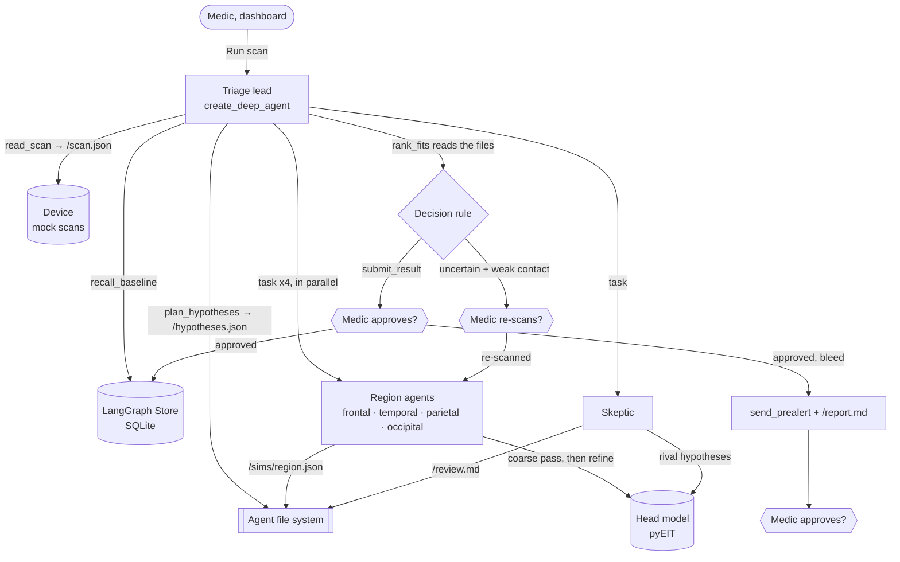

# Lucid agent

The deep agent behind the Lucid dashboard. A medic scans a patient's head with the handheld device; the agent works out whether a bleed is likely, where, and how big, by searching about 100 bleed hypotheses on a simulated head model. It stops for the medic before a re-scan, before it states a result, and before it hands off to a hospital.

Lucid is a screening aid, not a diagnosis.

Built on [LangChain deepagents](https://docs.langchain.com/oss/python/deepagents/overview) (`create_deep_agent`), served by LangGraph, traced in LangSmith.

## Run it

```bash
cd agent
uv venv --python 3.12 && uv pip install -r requirements.txt   # or: python -m venv .venv && .venv/bin/pip install -r requirements.txt
.venv/bin/langgraph dev --no-browser                           # http://localhost:2024, assistant id "lucid"
```

Keys are read from `../.env`: `ANTHROPIC_API_KEY`, and `LANGSMITH_API_KEY` for traces (project `lucid`).

Then start the dashboard from the repo root (`npm run dev`) and open http://localhost:3000/?live=1. Pick a mock scan, press **Run scan**, and answer when the agent pauses. Click any simulation card to see what the solver computed for it and what its agent is doing.

Without the dashboard:

```bash
.venv/bin/python tests/test_agent.py     # decision rule, gates and state, no model calls
.venv/bin/python tests/test_physics.py   # head model and the three mock scans
```

## Design



One scan, turn by turn:

1. **Read and plan.** In one turn the lead writes its to-dos, reads the scan (also saved to `/scan.json`), looks up the patient's baseline, and writes a coarse sweep of 96 hypotheses (3 types x 8 regions x 4 volumes) to `/hypotheses.json`.
2. **Search.** The lead says what stands out and starts the four region agents in parallel. Each reads its share from the file, simulates and scores it, then decides for itself whether anything is worth a closer look and adds finer volumes around its best candidates. Each writes its top three and a one-sentence finding to `/sims/<region>.json`. Meanwhile the lead scores the no-bleed model and reads the two wording skills.
3. **Rank and challenge.** `rank_fits` collects the four result files and applies the decision rule. In the same turn the skeptic reads the same files and tries to break the leading finding: other bleed types in the same place, neighbouring regions, the opposite side, or, when nothing fits, the smallest bleeds everywhere. Whatever it tests goes into the same pool of scores, so a real rival changes the outcome. It writes `/review.md`.
4. **Re-scan if the read is poor.** If the outcome is "uncertain" and some spots had weak contact, the agent asks the medic to scan those spots again and waits. With the new readings it runs steps 2 and 3 again.
5. **Propose.** The lead explains what the fit shows, writes the hand-off report to `/report.md`, and calls `submit_result`, which pauses for the medic.
6. **Hand off.** If the medic approves a bleed, `send_prealert` sends the report and pauses again before anything goes out.

About 35 s from **Run scan** to the first pause on all three mock scans.

### Decision rule

| Result | When |
|---|---|
| No bleed seen | The no-bleed model scores at least 0.80 and beats every bleed hypothesis by 0.05 |
| Uncertain, re-scan | The best bleed fit is below 0.80, or within 0.05 of the best fit in a different region or of the no-bleed model |
| Bleed likely | Otherwise. Region, volume and confidence come from the best fit |

The rule is code (`lucid/decision.py`), not prompt. The lead may be more cautious than the rule and propose "uncertain", but a proposal that claims more than the rule allows never reaches the medic: the approval gate's `when` check sends it straight back to the agent with the reason.

### Subagents

| Subagent | What it decides | Why it is a subagent |
|---|---|---|
| `frontal`, `temporal`, `parietal`, `occipital` | After a coarse pass over its lobe (left and right): whether anything is worth refining, which type and side, and which volumes to add | Four searches in parallel, and ~100 scores stay out of the lead's context; each hands back one sentence |
| `skeptic` | Which rival explanations to test against the leading finding, and whether it holds | A fresh context that has not seen the lead's reasoning, only the files |

All five run on the small model (`REGION_MODEL`) and have only `forward_sim`, `fit_score` and the file tools.

### Files

The file system is how the agents work together, and the tools check it.

| File | Written by | Read by |
|---|---|---|
| `/scan.json` | `read_scan`, `request_rescan` | Region agents, skeptic |
| `/hypotheses.json` | `plan_hypotheses` | Region agents |
| `/sims/<region>.json` | Each region agent | Skeptic; `rank_fits` (will not rank until all four exist) |
| `/review.md` | Skeptic | `submit_result` (refuses a result with no second opinion on file) |
| `/report.md` | Lead | `send_prealert` (sends it; refuses without it) |
| `/patients/<id>/baseline.json` | `submit_result`, on approval | `read_scan`, `recall_baseline`, on the patient's next scan |

It is a `CompositeBackend`:

| Path | Backend | Lifetime |
|---|---|---|
| Everything else above | `StateBackend` | One scan thread |
| `/skills/` | `FilesystemBackend` on `agent/skills` | The repo |
| `/patients/` | `StoreBackend` on a SQLite LangGraph Store (`data/lucid_store.sqlite`) | Across threads and restarts |

A patient's first approved scan becomes the baseline. The mock device returns a "15 minutes later" scan once a baseline exists, so running the temporal-bleed case twice for the same patient shows the comparison.

### Tools

| Tool | Who | Why |
|---|---|---|
| `read_scan` | lead | The only way in for device data: 8 spots, coil signal and NIR each. Mock scans for now; this is the one function to replace when hardware arrives |
| `recall_baseline` | lead | Loads the patient's first approved scan from the store |
| `plan_hypotheses` | lead | Writes the coarse sweep to `/hypotheses.json`, split by region agent |
| `forward_sim` | region agents, skeptic | The reading a hypothesis would produce on the head model. Also how an agent adds a hypothesis that is not in the sweep, with a note on why |
| `fit_score` | region agents, skeptic, lead | 0-1 match between a simulated reading and the scan. Weak-contact spots count less |
| `rank_fits` | lead | Collects the result files and applies the decision rule, so the arithmetic is never the model's. For a bleed it puts the best fit's map on the dashboard |
| `request_rescan` | lead | Asks the medic to re-scan weak-contact spots and reads the new values. Gated; once per scan |
| `render_map` | lead | A heatmap of any one hypothesis on the dashboard, when the medic asks to see an alternative |
| `submit_result` | lead | Records the result. Gated. Takes region, volume and confidence from the scores, not from the model |
| `send_prealert` | lead | The handoff, with `/report.md`. Gated, and only after a bleed result was approved. Simulated: there is no hospital link yet |

Plus the built-ins deepagents provides: `write_todos`, the file tools, and `task`.

### Skills

| Skill | What it holds |
|---|---|
| `skills/head-model` | What the readings mean, the tissue values in the model, the decision rule, and what a scan cannot show |
| `skills/explain-to-medic` | How to say a result in plain words: shape, vocabulary, worked examples |
| `skills/safety-wording` | Required and forbidden wording. "Screening aid, not a diagnosis." Never tell a patient they are fine |

### Middleware

| Middleware | What it does |
|---|---|
| `TodoListMiddleware` | The to-do list |
| `HumanInTheLoopMiddleware` (via `interrupt_on`) | The three pauses, each with a `when` check and a card text built from state |
| `ActivityLog` (ours, on every subagent) | Streams each subagent's tool calls and replies to the dashboard as they happen |
| `TodoProgress` (ours) | Moves the to-do list forward from the lead's tool calls when the lead does not |
| `CloseOut` (ours) | Finishes the list, and on a rejection marks the scan as having no result and removes the drafted report |

## What the dashboard reads

The UI connects with the LangGraph SDK (`useStream`) and reads thread state directly:

| State key | Shape (see `/lib/types.ts`) |
|---|---|
| `todos` | `{content, status}[]` |
| `sims` | `Simulation[]`: `id, type, region, volume_ml, status, score, map` (32x32), `agent, progress`, plus `pass` (coarse / refine / review), `by`, `note`, `reading`, `misfit` |
| `scan` | `ScanUpdate`: `status, region, volume_ml, confidence, map` (64x64). `status` is `"pending"` until the medic approves, `"rejected"` if they turn the proposal down |
| `spots`, `reading` | The 8 scan spots and their raw readings |
| `preview` | `{hypothesis_id, map}` while a result waits for approval |
| `handoff` | `{to, message, report, sent_at, simulated}` after a pre-alert |

Tools also emit `custom` stream events (`scan`, `sims_reset`, `sims`, `preview`, `handoff`, `activity`) so the grid fills and the subagents' steps show while they are still working. Pauses arrive as interrupts; the UI resumes with `{decisions: [{type: "approve"}]}` or `{type: "reject", message}`.

Two extra routes (`lucid/http.py`, mounted through `langgraph.json`) serve the simulation detail view with a live pyEIT solve:

| Route | Returns |
|---|---|
| `GET /lucid/mesh` | The head mesh: nodes, triangles, tissue per triangle, the electrode pair each scan spot drives |
| `GET /lucid/sim/{id}` | One hypothesis: blood and conductivity per triangle, and for each scan spot how much the bleed shifts the potential at every node |

## Configuration

Everything is in `lucid/config.py`.

| Setting | Default | Note |
|---|---|---|
| `LUCID_MODEL` | `anthropic:claude-sonnet-5` | The lead. The one line to change for AWS Bedrock: `bedrock_converse:<model id>` plus `pip install langchain-aws` |
| `LUCID_REGION_MODEL` | `anthropic:claude-haiku-5-5` | Region agents and the skeptic |
| `MIN_FIT`, `MIN_MARGIN` | 0.80, 0.05 | The decision rule |
| `COARSE_VOLUMES` | 10, 20, 30, 40 mL | The sweep the region agents refine from |
| `LUCID_SIM_PACE_S` | 0.03 | The lookup table answers instantly; simulation events are spaced by this much so a person can watch the grid fill |

Extended thinking is switched off: every step is a short tool turn, and thinking added 5 to 8 seconds to each.

## Honest limits

- No hardware. `read_scan` serves three mock scans: `temporal_bleed`, `clear`, `uncertain`. The re-scan returns cleaner mock readings for the spots the medic was asked to redo.
- The head model is a coarse 2D proxy. pyEIT solves an electrical-impedance forward problem; we map its boundary voltages to a coil signal in dB and add a simple NIR absorption term. It is not a validated solver for the device.
- One bleed per hypothesis. Volumes are good to about 5 mL at best; neighbouring volumes often tie.
- The uncertain mock scan is picked so that a re-scan resolves it; with other noise draws it can stay uncertain.
- The pre-alert is simulated.

## Layout

```
agent/
  langgraph.json        graph "lucid", SQLite store, extra routes, env file
  lucid/
    agent.py            create_deep_agent: lead, subagents, gates, middleware
    prompts.py          lead, region and skeptic prompts
    tools.py            the tools above
    decision.py         the decision rule
    state.py            state keys the dashboard reads
    backend.py          the file system (state + skills + store)
    store.py            SQLite LangGraph Store
    http.py             solver routes for the detail view
    config.py           models and thresholds
    physics/            head model, mock scans, fit score, maps
  skills/               three SKILL.md files
  data/                 precomputed lookup table and mesh
  tests/
```
