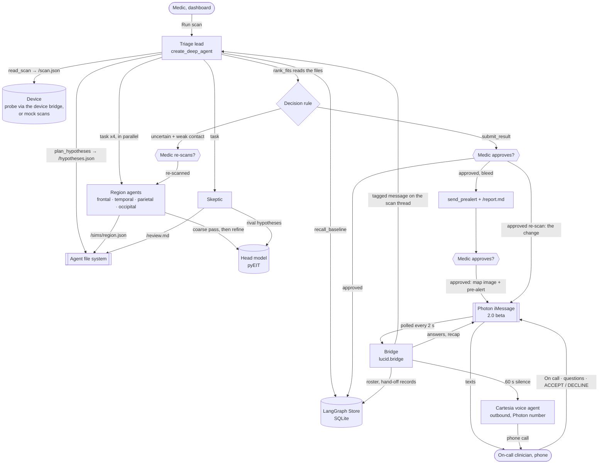

# Lucid agent

The deep agent behind the Lucid dashboard. A medic scans a patient's head with the handheld device; the agent works out whether a bleed is likely, where, and how big, by searching about 100 bleed hypotheses on a simulated head model. It stops for the medic before a re-scan, before it states a result, and before it hands off to a hospital.

Lucid is a screening aid, not a diagnosis.

Built on [LangChain deepagents](https://docs.langchain.com/oss/python/deepagents/overview) (`create_deep_agent`), served by LangGraph, traced in LangSmith.

## Run it

```bash
cd agent
uv venv --python 3.12 && uv pip install -r requirements.txt   # or: python -m venv .venv && .venv/bin/pip install -r requirements.txt
.venv/bin/langgraph dev --no-browser                           # http://localhost:2024, assistant id "lucid"
```

Keys are read from `../.env`: `ANTHROPIC_API_KEY`, and `LANGSMITH_API_KEY` for traces (project `lucid`).

Then start the dashboard from the repo root (`npm run dev`) and open http://localhost:3000/?live=1. Pick a mock scan, press **Run scan**, and answer when the agent pauses. Click any simulation card to see what the solver computed for it and what its agent is doing.

Without the dashboard:

```bash
.venv/bin/python tests/test_agent.py     # decision rule, gates and state, no model calls
.venv/bin/python tests/test_physics.py   # head model and the three mock scans
.venv/bin/python tests/test_photon.py    # pre-alert request bodies, roster, HTTP layer, hand-off fallbacks
.venv/bin/python tests/test_bridge.py    # the bridge and record_reply: roster, paused threads, delivery, silence
.venv/bin/python tests/test_memory.py    # the re-scan update and clinician notes
.venv/bin/python tests/test_voice.py     # call requests, decisions from a transcript, polling
.venv/bin/python tests/test_device.py        # the device bridge on synthetic streams: protocol, calibration, spot capture, HTTP
.venv/bin/python tests/test_device_tools.py  # read_scan and request_rescan against a patched bridge
```

None of them calls a model or the network.

## Design



One scan, turn by turn:

1. **Read and plan.** In one turn the lead writes its to-dos, reads the scan (also saved to `/scan.json`), looks up the patient's baseline, and writes a coarse sweep of 96 hypotheses (3 types x 8 regions x 4 volumes) to `/hypotheses.json`.
2. **Search.** The lead says what stands out and starts the four region agents in parallel. Each reads its share from the file, simulates and scores it, then decides for itself whether anything is worth a closer look and adds finer volumes around its best candidates. Each writes its top three and a one-sentence finding to `/sims/<region>.json`. Meanwhile the lead scores the no-bleed model and reads the two wording skills.
3. **Rank and challenge.** `rank_fits` collects the four result files and applies the decision rule. In the same turn the skeptic reads the same files and tries to break the leading finding: other bleed types in the same place, neighbouring regions, the opposite side, or, when nothing fits, the smallest bleeds everywhere. Whatever it tests goes into the same pool of scores, so a real rival changes the outcome. It writes `/review.md`.
4. **Re-scan if the read is poor.** If the outcome is "uncertain" and some spots had weak contact, the agent asks the medic to scan those spots again and waits. With the new readings it runs steps 2 and 3 again.
5. **Propose.** The lead explains what the fit shows, writes the hand-off report to `/report.md`, and calls `submit_result`, which pauses for the medic.
6. **Hand off.** If the medic approves a bleed, `send_prealert` pauses again, naming the on-call clinician, and on approval texts them the map image and the pre-alert by iMessage. The report stays on record. Without a Photon key the hand-off is recorded as simulated and nothing is sent.
7. **Talk to the clinician.** Their texts come back onto the same thread through the bridge; the lead answers from the scan, records ACCEPT or DECLINE, and remembers a standing preference ("always include contact quality") for their next pre-alert. If no decision comes 60 s after the pre-alert or their last text, the bridge tells the medic and, with voice configured, phones the clinician.
8. **Re-scan.** When the medic approves a later scan of the same patient, the clinician who accepted the hand-off is texted the change since the first scan (built in code from the two approved results), instead of a new pre-alert. The result card says so before it is approved.

About 35 s from **Run scan** to the first pause on all three mock scans.

### Decision rule

| Result | When |
|---|---|
| No bleed seen | The no-bleed model scores at least 0.80 and beats every bleed hypothesis by 0.05 |
| Uncertain, re-scan | The best bleed fit is below 0.80, or within 0.05 of the best fit in a different region or of the no-bleed model |
| Bleed likely | Otherwise. Region, volume and confidence come from the best fit |

The rule is code (`lucid/decision.py`), not prompt. The lead may be more cautious than the rule and propose "uncertain", but a proposal that claims more than the rule allows never reaches the medic: the approval gate's `when` check sends it straight back to the agent with the reason.

### Subagents

| Subagent | What it decides | Why it is a subagent |
|---|---|---|
| `frontal`, `temporal`, `parietal`, `occipital` | After a coarse pass over its lobe (left and right): whether anything is worth refining, which type and side, and which volumes to add | Four searches in parallel, and ~100 scores stay out of the lead's context; each hands back one sentence |
| `skeptic` | Which rival explanations to test against the leading finding, and whether it holds | A fresh context that has not seen the lead's reasoning, only the files |

All five run on the small model (`REGION_MODEL`) and have only `forward_sim`, `fit_score` and the file tools.

### Files

The file system is how the agents work together, and the tools check it.

| File | Written by | Read by |
|---|---|---|
| `/scan.json` | `read_scan`, `request_rescan` | Region agents, skeptic |
| `/hypotheses.json` | `plan_hypotheses` | Region agents |
| `/sims/<region>.json` | Each region agent | Skeptic; `rank_fits` (will not rank until all four exist) |
| `/review.md` | Skeptic | `submit_result` (refuses a result with no second opinion on file) |
| `/report.md` | Lead | `send_prealert` (keeps it on the hand-off record; refuses without it) |
| `/patients/<id>/baseline.json` | `submit_result`, on approval | `read_scan`, `recall_baseline`, on the patient's next scan; the re-scan update |
| `/clinicians/<handle>/notes.md` | `remember_preference`, when the clinician states a standing preference | `rank_fits`, which passes the on-call clinician's notes on before the pre-alert is written |

It is a `CompositeBackend`:

| Path | Backend | Lifetime |
|---|---|---|
| Everything else above | `StateBackend` | One scan thread |
| `/skills/` | `FilesystemBackend` on `agent/skills` | The repo |
| `/patients/` | `StoreBackend` on a SQLite LangGraph Store (`data/lucid_store.sqlite`) | Across threads and restarts |
| `/clinicians/` | `StoreBackend`, same Store, namespace `lucid/clinicians` | Across threads, patients and restarts |

A patient's first approved scan becomes the baseline. The mock device returns a "15 minutes later" scan once a baseline exists, so running the temporal-bleed case twice for the same patient shows the comparison.

### Tools

| Tool | Who | Why |
|---|---|---|
| `read_scan` | lead | The only way in for device data: 8 spots, coil signal and NIR each. Mock scans in Simulated device mode; in Device mode (scan `device`) the 8 spots the medic read on the probe, from the device bridge (`lucid/device`) |
| `recall_baseline` | lead | Loads the patient's first approved scan from the store |
| `plan_hypotheses` | lead | Writes the coarse sweep to `/hypotheses.json`, split by region agent |
| `forward_sim` | region agents, skeptic | The reading a hypothesis would produce on the head model. Also how an agent adds a hypothesis that is not in the sweep, with a note on why |
| `fit_score` | region agents, skeptic, lead | 0-1 match between a simulated reading and the scan. Weak-contact spots count less |
| `rank_fits` | lead | Collects the result files and applies the decision rule, so the arithmetic is never the model's. For a bleed it puts the best fit's map on the dashboard |
| `request_rescan` | lead | Asks the medic to re-scan weak-contact spots and reads the new values. Gated; once per scan |
| `render_map` | lead | A heatmap of any one hypothesis on the dashboard, when the medic asks to see an alternative |
| `submit_result` | lead | Records the result. Gated. Takes region, volume and confidence from the scores, not from the model |
| `send_prealert` | lead | The hand-off: the map image and the pre-alert, by iMessage, to the on-call clinician the approval card names. Gated, and only after a bleed result was approved. Without a Photon key it is recorded as simulated |
| `record_reply` | lead | Records the clinician's ACCEPT or DECLINE. Not gated, but refuses unless their latest message says so in words (or a call's `decision:` field) |
| `remember_preference` | lead | Appends a clinician's standing preference to their notes. Format or content only, never a clinical threshold |

Plus the built-ins deepagents provides: `write_todos`, the file tools, and `task`.

### Skills

| Skill | What it holds |
|---|---|
| `skills/head-model` | What the readings mean, the tissue values in the model, the decision rule, and what a scan cannot show |
| `skills/explain-to-medic` | How to say a result in plain words: shape, vocabulary, worked examples |
| `skills/safety-wording` | Required and forbidden wording. "Screening aid, not a diagnosis." Never tell a patient they are fine |
| `skills/text-a-clinician` | How to answer the receiving clinician by text: the number first, what the scan cannot show, accept and decline |

### Middleware

| Middleware | What it does |
|---|---|
| `TodoListMiddleware` | The to-do list |
| `HumanInTheLoopMiddleware` (via `interrupt_on`) | The three pauses, each with a `when` check and a card text built from state |
| `ActivityLog` (ours, on every subagent) | Streams each subagent's tool calls and replies to the dashboard as they happen |
| `TodoProgress` (ours) | Moves the to-do list forward from the lead's tool calls when the lead does not |
| `CloseOut` (ours) | Finishes the list, and on a rejection marks the scan as having no result and removes the drafted report |

## What the dashboard reads

The UI connects with the LangGraph SDK (`useStream`) and reads thread state directly:

| State key | Shape (see `/lib/types.ts`) |
|---|---|
| `todos` | `{content, status}[]` |
| `sims` | `Simulation[]`: `id, type, region, volume_ml, status, score, map` (32x32), `agent, progress`, plus `pass` (coarse / refine / review), `by`, `note`, `reading`, `misfit` |
| `scan` | `ScanUpdate`: `status, region, volume_ml, confidence, map` (64x64). `status` is `"pending"` until the medic approves, `"rejected"` if they turn the proposal down |
| `spots`, `reading` | The 8 scan spots and their raw readings |
| `preview` | `{hypothesis_id, map}` while a result waits for approval |
| `handoff` | After a pre-alert: `{to, message, report, sent_at, simulated}`, plus `channel: "imessage"`, `status` and `reply` when it went by iMessage (`to` is masked). After a re-scan update it is the update, with `kind: "update"`. Live delivery, replies and calls are in the Store record below |

Tools and middleware also emit `custom` stream events (`scan`, `sims_reset`, `sims`, `preview`, `handoff`, `activity`, `todos`) so the grid fills and the subagents' steps show while they are still working. Pauses arrive as interrupts; the UI resumes with `{decisions: [{type: "approve"}]}` or `{type: "reject", message}`.

Two extra routes (`lucid/http.py`, mounted through `langgraph.json`) serve the simulation detail view with a live pyEIT solve:

| Route | Returns |
|---|---|
| `GET /lucid/mesh` | The head mesh: nodes, triangles, tissue per triangle, the electrode pair each scan spot drives |
| `GET /lucid/sim/{id}` | One hypothesis: blood and conductivity per triangle, and for each scan spot how much the bleed shifts the potential at every node |

## Hand-off over iMessage

`PHOTON_PROJECT_ID` and `PHOTON_API_KEY` in `../.env` turn it on. A clinician texts "On call" to the Photon number they were assigned; "Off" takes them off. The pre-alert goes to the active clinician who came on call most recently. They must be on call when the medic approves the bleed result: the recipient is looked up then (state key `recipient`), named on the pre-alert card, and checked again just before the send. With nobody on call the card says so and nothing is sent.

Then run the bridge next to the agent server:

```bash
.venv/bin/python -m lucid.bridge                 # polls Photon every 2 s; LANGGRAPH_URL defaults to http://localhost:2024
.venv/bin/python -m lucid.photon oncall +1...    # or put someone on call by hand (also: off, sync, roster)
```

The bridge answers roster texts in code, sends anyone without an open hand-off (one sent to them in the last 12 hours) one fixed line, and puts the clinician's other texts on the scan thread for the lead to answer. While the thread waits at an approval card it holds the text and replies "The medic is deciding. I will reply shortly." It follows delivery and tells the medic when a pre-alert could not be delivered. Once per hand-off, if no decision has come `LUCID_CALL_AFTER_S` (60) after the later of the pre-alert and the clinician's latest text, it phones the clinician when voice is configured and their handle is a phone number; otherwise it tells the medic. A text decision takes precedence over a phone decision.

| Store namespace, key | Value |
|---|---|
| `lucid/oncall`, handle | `{handle, space_id, agent_user_id, since, active}` |
| `lucid/handoffs`, thread id | `{thread_id, patient_id, to, space_id, agent_user_id, sent_at, message, report, status, messages: [{id, kind, status}], reply, call, simulated}`. `status` is sent, delivered, failed or no_one_on_call (read is allowed, but Photon's beta reports no read status); a message's status is queued, delivered or failed. `reply` is `{decision, note, at, via}`. `call` is `{status, started_at, conversation_id, summary, duration_s}`, with status ringing, answered, no_answer, failed or cancelled. A failed send adds `error`; the bridge adds `delivered_at`, `clinician_at` and `no_reply_at`. The record also carries `transport` and `medic_notes` (with a rendered `text`); after a call, `call` has `answered_at` and `ended_at`, and the code-built recap (or "I tried to call") is in `messages` with `kind: "recap"`. A re-scan update appends `{id, kind: "update", status}` to the accepted record's `messages`; a re-scan on a new thread also gets its own record with `update_of` = the accepted thread |
| `lucid/bridge`, `cursor` | `{since, handled: {message id: createdAt}}`, so a restart neither replays nor skips |

On the thread, the bridge's messages are human messages tagged `[Receiving clinician, iMessage] ...`, `[Receiving clinician, phone call] ...` or `[Hand-off channel] ...`, and every run it starts carries metadata `{"source": "photon-bridge", "kind": "clinician" | "call" | "channel"}`. Answers to a channel event go to the medic only.

| Variable | Read by | Use |
|---|---|---|
| `PHOTON_PROJECT_ID`, `PHOTON_API_KEY` | agent server, bridge | Photon's HTTP API. Without them the pre-alert is simulated and the bridge does not start |
| `LUCID_PHOTON_PREFIX` | agent server, bridge | Put in front of every text, e.g. `"[Lucid test] "` on test servers. Unset, the texts look like real clinical alerts |
| `LANGGRAPH_URL` | bridge, `lucid.photon` | Where the agent server is. Default `http://localhost:2024` |
| `LUCID_CALL_AFTER_S` | bridge | Silence before the call, or before the medic is told. Default 60 |
| `LUCID_BRIDGE_LOG` | bridge | Log level. Default `INFO` |
| `CARTESIA_API_KEY`, `CARTESIA_AGENT_ID`, `CARTESIA_FROM_NUMBER_ID` | bridge | Voice. Any one missing or empty means no calls: `CARTESIA_FROM_NUMBER_ID= .venv/bin/python -m lucid.bridge` runs the bridge without voice |

Saving any file under `agent/` makes `langgraph dev` reload, which cancels a scan in progress.

### Phone call when the clinician is silent

Built, and tested with the call stubbed; not yet proven on a real phone.

The bridge puts "No reply after 60 s. Calling the on-call clinician." on the thread as a channel event, then places an outbound call through a Cartesia managed agent and a Photon SIP trunk (`lucid/voice.py`). The call agent gets the approved pre-alert, the report and the best fit per region as variables. It reads the pre-alert, answers from those, and asks for accept or decline. A question texted before the call is dialled restarts the clock instead.

When the call ends, the decision is taken in code from the clinician's own words: accept or decline, not both, not negated; anything else is no decision. The transcript goes on the thread as `[Receiving clinician, phone call] decision: ...`, the lead records the decision, and its recap is texted to the clinician. An unanswered or failed call tells the medic and, unless a decision came in meanwhile, texts the clinician "I tried to call at ... about a pre-alert. Reply ACCEPT or DECLINE."

Setup, from `agent/`: `.venv/bin/python -m lucid.voice setup`. It creates or reuses the Cartesia agent and Photon's default SIP profile, configures the profile, creates an outbound Cartesia SIP trunk, and imports the Photon number. Set `PHOTON_VOICE_NUMBER` (E.164) and re-run it once the number is bought; it resumes from what exists. Photon requires a payment method for outbound calls, and the number must be active before a call.

The root `.env` supplies `PHOTON_PROJECT_ID`, `PHOTON_API_KEY`, `CARTESIA_API_KEY` and `PHOTON_VOICE_NUMBER`. Setup appends `PHOTON_SIP_USERNAME`, `PHOTON_SIP_PASSWORD`, `CARTESIA_INBOUND_USERNAME`, `CARTESIA_INBOUND_PASSWORD`, `CARTESIA_AGENT_ID` and `CARTESIA_FROM_NUMBER_ID`, so the file holds credentials. Photon shows the outbound SIP password once; if it is missing for a profile that already exists, setup stops for manual recovery rather than rotating it.

Inbound calls to the number do not work. Cartesia refused every inbound trunk configuration tried, so the trunk is outbound only and the number is not assigned to an agent.

`.venv/bin/python -m lucid.voice call +1...` places one test call and prints its outcome. Calls cost money; tell the person holding the phone first. The voice module re-reads the root `.env` each time it checks whether voice is on, so a running bridge picks up ids that setup added; variables already set in the process win.

## Configuration

Everything is in `lucid/config.py`, except the hand-off's variables, which are listed under [Hand-off over iMessage](#hand-off-over-imessage).

| Setting | Default | Note |
|---|---|---|
| `LUCID_MODEL` | `anthropic:claude-sonnet-5` | The lead. The one line to change for AWS Bedrock: `bedrock_converse:<model id>` plus `pip install langchain-aws` |
| `LUCID_REGION_MODEL` | `anthropic:claude-haiku-5-5` | Region agents and the skeptic |
| `MIN_FIT`, `MIN_MARGIN` | 0.80, 0.05 | The decision rule |
| `COARSE_VOLUMES` | 10, 20, 30, 40 mL | The sweep the region agents refine from |
| `LUCID_MEDIC_NOTES` | Male, about 40; ladder fall 25 min ago; GCS 13, pupils equal and reactive; BP 152/88, HR 96 | The simulated medic's notes: JSON with any of `age_sex`, `mechanism`, `gcs`, `pupils`, `bp`, `hr`, or one sentence. In the scan, `/scan.json`, `/report.md`, the hand-off record and the call; not in the pre-alert text |
| `LUCID_UNIT`, `LUCID_ETA_MIN`, `LUCID_ORIGIN` | Medic 12, 12, on scene, en route | The simulated transport: which unit has the patient and how far out. In the scan, `/scan.json`, the pre-alert, the hand-off record and the call |
| `LUCID_SIM_PACE_S` | 0.03 | The lookup table answers instantly; simulation events are spaced by this much so a person can watch the grid fill |

Extended thinking is switched off: every step is a short tool turn, and thinking added 5 to 8 seconds to each.

## Honest limits

- The transport (unit, ETA, origin) and the medic's notes (age, mechanism, GCS, pupils, vitals) are simulated from `lucid/config.py`, like the device. No dispatch, GPS or patient-record link.
- Simulated device mode serves three mock scans: `temporal_bleed`, `clear`, `uncertain`; its re-scan returns cleaner mock readings for the spots the medic was asked to redo.
- Device mode reads the probe through the device bridge. That path is tested on synthetic streams only (`tests/test_device.py`, `tests/test_device_tools.py`); the head model has not been calibrated against bench readings, so fit scores on real readings are not yet meaningful. See [`../docs/validation.md`](../docs/validation.md).
- The head model is a coarse 2D proxy. pyEIT solves an electrical-impedance forward problem; we map its boundary voltages to a coil signal in dB and add a simple NIR absorption term. It is not a validated solver for the device.
- One bleed per hypothesis. Volumes are good to about 5 mL at best; neighbouring volumes often tie.
- The uncertain mock scan is picked so that a re-scan resolves it; with other noise draws it can stay uncertain.
- The pre-alert, the answers and the re-scan update are real iMessages through Photon's 2.0 beta, but they go to a teammate playing the on-call surgeon. Without a Photon key the pre-alert is simulated and nothing is sent.
- The patients are mock. Texts carry a patient id, made per dashboard page load, never a name.
- Photon's beta reports no read receipts, so a hand-off never shows "read".
- The phone call is built and tested with the call stubbed; it has not yet been proven on a real phone. Inbound calls to the number do not work.

## Layout

```
agent/
  langgraph.json        graph "lucid", SQLite store, extra routes, env file
  lucid/
    agent.py            create_deep_agent: lead, subagents, gates, middleware
    prompts.py          lead, region and skeptic prompts
    tools.py            the tools above
    decision.py         the decision rule
    photon.py           Photon iMessage over HTTP, the on-call roster
    bridge.py           the long-running process between Photon and the scan threads
    voice.py            Cartesia calls over a Photon SIP trunk, and their setup
    state.py            state keys the dashboard reads
    backend.py          the file system (state + skills + store)
    store.py            SQLite LangGraph Store
    http.py             solver routes for the detail view
    config.py           models and thresholds
    physics/            head model, mock scans, fit score, maps, the map image that is texted
  skills/               four SKILL.md files
  data/                 precomputed lookup table and mesh
  tests/
```
