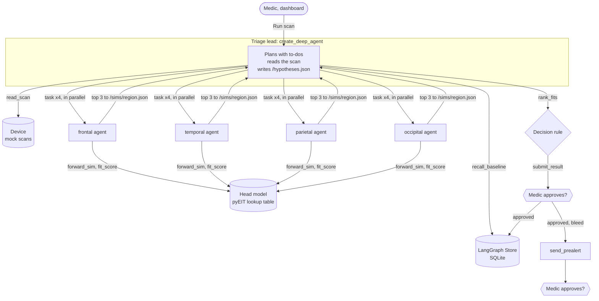

# Lucid agent

The deep agent behind the Lucid dashboard. A medic scans a patient's head with the handheld device; the agent works out whether a bleed is likely, where, and how big, by testing about 100 bleed hypotheses against a simulated head model. It pauses for the medic's approval before it states a result and before it hands off to a hospital.

Lucid is a screening aid, not a diagnosis.

Built on [LangChain deepagents](https://docs.langchain.com/oss/python/deepagents/overview) (`create_deep_agent`), served by LangGraph, traced in LangSmith.

## Run it

```bash
cd agent
uv venv --python 3.12 && uv pip install -r requirements.txt   # or: python -m venv .venv && .venv/bin/pip install -r requirements.txt
.venv/bin/langgraph dev --no-browser                           # http://localhost:2024, assistant id "lucid"
```

Keys are read from `../.env`: `ANTHROPIC_API_KEY`, and `LANGSMITH_API_KEY` for traces (project `lucid`).

Then start the dashboard from the repo root (`npm run dev`) and open http://localhost:3000/?live=1. Pick a mock scan, press **Run scan**, and approve or reject when the agent pauses.

Without the dashboard:

```bash
.venv/bin/python tests/test_agent.py     # decision rule and state, no model calls
.venv/bin/python tests/test_physics.py   # head model and the three mock scans
```

## Design



One scan, turn by turn:

1. The lead writes its five to-dos, reads the scan and looks up the patient's baseline, all in one turn.
2. It says what stands out in the readings and plans about 100 hypotheses, dense in the regions the readings point to and coarse elsewhere. `/hypotheses.json` goes into the agent's file system.
3. It starts the four region agents in parallel, scores the no-bleed model itself, and reads the two wording skills, again in one turn. Each region agent reads its share of the file, simulates and scores it, and writes its top 3 to `/sims/<region>.json`.
4. `rank_fits` applies the decision rule.
5. The lead explains what the fit shows and proposes a result. `submit_result` pauses for the medic.
6. If the medic approves a bleed, `send_prealert` pauses again before anything is handed off.

About 30 s from **Run scan** to the first approval card on all three mock scans.

### Decision rule

| Result | When |
|---|---|
| No bleed seen | The no-bleed model scores at least 0.80 and beats every bleed hypothesis by 0.05 |
| Uncertain, re-scan | The best bleed fit is below 0.80, or within 0.05 of the best fit in a different region or of the no-bleed model |
| Bleed likely | Otherwise. Region, volume and confidence come from the best fit |

The rule is code (`lucid/decision.py`), not prompt. The lead may be more cautious than the rule and propose "uncertain", but a proposal that claims more than the rule allows never reaches the medic: the approval gate's `when` check sends it straight back to the agent with the reason.

### Why each tool exists

| Tool | Who | Why |
|---|---|---|
| `read_scan` | lead | The only way in for device data: 8 spots, coil signal and NIR each. Mock scans for now; this is the one function to replace when hardware arrives |
| `recall_baseline` | lead | Loads the patient's first approved scan from the store, so a re-scan is judged against the same head 15 minutes earlier |
| `plan_hypotheses` | lead | The lead chooses where to look; the tool expands that into ~100 type x region x volume hypotheses and writes `/hypotheses.json`. Keeps the choice with the model and the bookkeeping out of its context |
| `forward_sim` | region agents | The reading a hypothesis would produce on the head model. pyEIT on a coarse 2D head mesh, precomputed into a lookup table so it answers instantly |
| `fit_score` | region agents, lead | 0-1 match between a simulated reading and the scan. Weak-contact spots count less |
| `rank_fits` | lead | Applies the decision rule to all scores, so the arithmetic is never the model's |
| `render_map` | lead | Puts the map of the proposed finding on the dashboard, so the medic sees what they are approving |
| `submit_result` | lead | Records the result. Gated by `interrupt_on`. Takes region, volume and confidence from the scores, not from the model |
| `send_prealert` | lead | The handoff. Gated by `interrupt_on`, and only possible after a bleed result was approved. Simulated: there is no hospital link yet |

Plus the built-ins deepagents provides: `write_todos`, the file tools, and `task`.

### Why each subagent exists

Four region agents: `frontal`, `temporal`, `parietal`, `occipital`. Each takes the left and right hypotheses for its lobe. They exist for two reasons. They run in parallel, which is what makes 100 simulations fit in a demo. And they keep ~100 simulation results out of the lead's context: each one hands back three lines.

They run on the small model (`REGION_MODEL`), since the job is mechanical.

### Skills

| Skill | What it holds |
|---|---|
| `skills/head-model` | What the readings mean, the tissue values in the model, how to choose focus regions, the decision rule, and what a scan cannot show |
| `skills/explain-to-medic` | How to say a result in plain words: shape, vocabulary, worked examples |
| `skills/safety-wording` | Required and forbidden wording. "Screening aid, not a diagnosis." Never tell a patient they are fine |

### Memory

The agent's file system is a `CompositeBackend`:

| Path | Backend | Lifetime |
|---|---|---|
| `/hypotheses.json`, `/sims/*.json` | `StateBackend` | One scan thread |
| `/skills/` | `FilesystemBackend` on `agent/skills` | The repo |
| `/patients/<id>/baseline.json` | `StoreBackend` on a SQLite LangGraph Store (`data/lucid_store.sqlite`) | Across threads and restarts |

A patient's first approved scan becomes the baseline. The mock device returns a "15 minutes later" scan once a baseline exists, so running the temporal-bleed case twice for the same patient shows the comparison.

## What the dashboard reads

The UI connects with the LangGraph SDK (`useStream`) and reads thread state directly:

| State key | Shape (see `/lib/types.ts`) |
|---|---|
| `todos` | `{content, status}[]` |
| `sims` | `Simulation[]`: `id, type, region, volume_ml, status, score, map` (32x32), `agent, progress` |
| `scan` | `ScanUpdate`: `status, region, volume_ml, confidence, map` (64x64). `status` is `"pending"` until the medic approves |
| `spots` | `ScanSpot[]` |
| `preview` | `{hypothesis_id, map}` while a result waits for approval |
| `handoff` | `{to, message, sent_at, simulated}` after a pre-alert |

Tools also emit `custom` stream events (`scan`, `sims_reset`, `sims`, `preview`, `handoff`) so the grid fills while the region agents are still working. Approval pauses arrive as interrupts; the UI resumes with `{decisions: [{type: "approve"}]}` or `{type: "reject", message}`.

## Configuration

Everything is in `lucid/config.py`.

| Setting | Default | Note |
|---|---|---|
| `LUCID_MODEL` | `anthropic:claude-sonnet-5` | The one line to change for AWS Bedrock: `bedrock_converse:<model id>` plus `pip install langchain-aws` |
| `LUCID_REGION_MODEL` | `anthropic:claude-haiku-5-5` | Region agents |
| `MIN_FIT`, `MIN_MARGIN` | 0.80, 0.05 | The decision rule |
| `LUCID_SIM_PACE_S` | 0.06 | The lookup table answers instantly; simulation events are spaced by this much so a person can watch the grid fill |

Extended thinking is switched off: every step is a short tool turn, and thinking added 5 to 8 seconds to each.

## Honest limits

- No hardware. `read_scan` serves three mock scans: `temporal_bleed`, `clear`, `uncertain`.
- The head model is a coarse 2D proxy. pyEIT solves an electrical-impedance forward problem; we map its boundary voltages to a coil signal in dB and add a simple NIR absorption term. It is not a validated solver for the device.
- One bleed per hypothesis. Volumes are good to about 5 mL at best; neighbouring volumes often tie.
- The pre-alert is simulated.

## Layout

```
agent/
  langgraph.json        graph "lucid", SQLite store, env file
  lucid/
    agent.py            create_deep_agent: lead, region agents, approval gates
    prompts.py          lead and region prompts
    tools.py            the tools above
    decision.py         the decision rule
    state.py            state keys the dashboard reads
    backend.py          the file system (state + skills + store)
    store.py            SQLite LangGraph Store
    config.py           models and thresholds
    physics/            head model, mock scans, fit score, maps
  skills/               three SKILL.md files
  data/                 precomputed lookup table and mesh
  tests/
```
